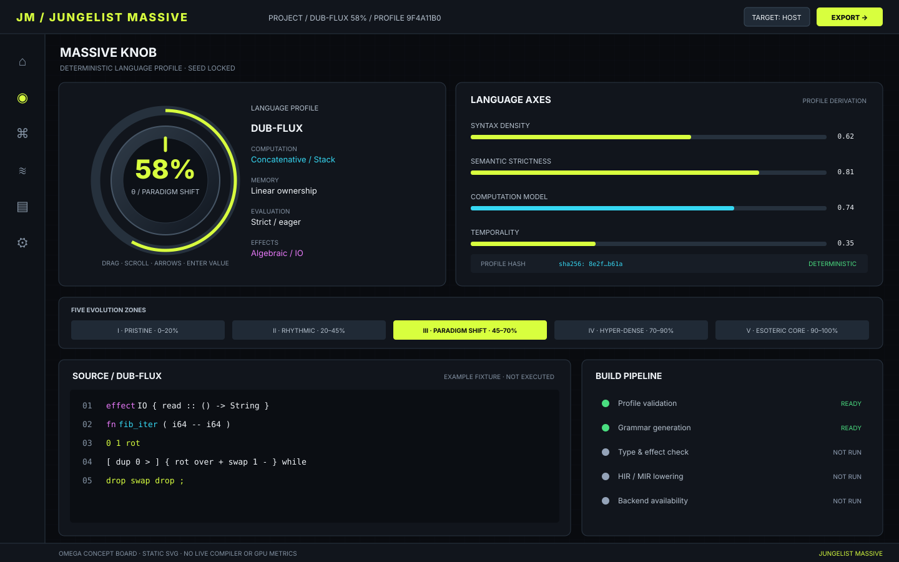

# Jungelist Massive

**Native language-design studio and compiler workbench**  
**Design lineage:** 7.7.7-OMEGA

<em>Static product-design concept; not a running compiler screenshot or evidence that the shown backends are implemented.</em>

## Product direction

Jungelist Massive explores deterministic language-profile generation through the Massive Knob. A profile describes syntax, types, computation, evaluation, memory and effects; compiler stages validate generated artifacts before execution or export.

## Design and architecture

- [OMEGA native studio design and implementation contract](design/OMEGA_NATIVE_STUDIO.md)
- [Machine-readable visual tokens](design/omega.tokens.json)
- [Repository-wide product upgrade and verification gates](docs/OMEGA_PRODUCT_UPGRADE.md)

## Planned compiler pipeline

Profile → lexicon → grammar/parser → type/effect checking → HIR/MIR → backend → artifact.

Z3, Cranelift, LLVM, wgpu, LSP and multi-platform packaging are capability-gated integrations. They must not be advertised as working until implementation, tests and platform evidence exist.

## Engineering principles

- Deterministic profile generation from schema version, generator version, seed and knob value.
- Separate, testable compiler stages and stable intermediate representations.
- Explicit diagnostics, cancellation, resource limits and sandbox boundaries.
- Measured p50/p95/p99 latency and platform-specific performance claims.
- Accessible keyboard-operated macro control, direct numeric entry, visible focus and reduced motion.

## Status

Design assets and architecture documents are specifications, not runtime implementation evidence. See the open OMEGA pull request for the current change set.
